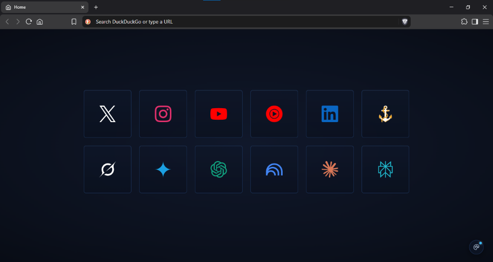
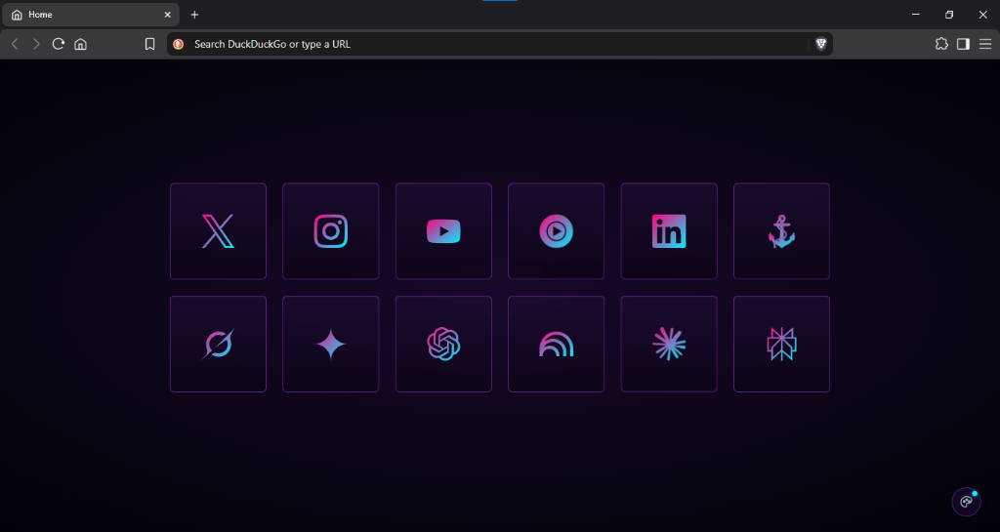

# sami-startpage

Personal custom start page for my Brave browser profile. This repository is strictly for personal backup of my page.

It replaces NightTab with a local unpacked extension. Shows my daily bookmarks in a simple 6x2 grid with SVG icons and a small theme switcher in the bottom-right corner.

### Preview

### Setup

1. Open `brave://extensions` in Brave.
2. Turn on Developer mode (top-right).
3. Click "Load unpacked" and select this folder.
4. Press `Ctrl + T` to open a new tab.

Shortcuts and URLs live in `scripts/config.js`.
